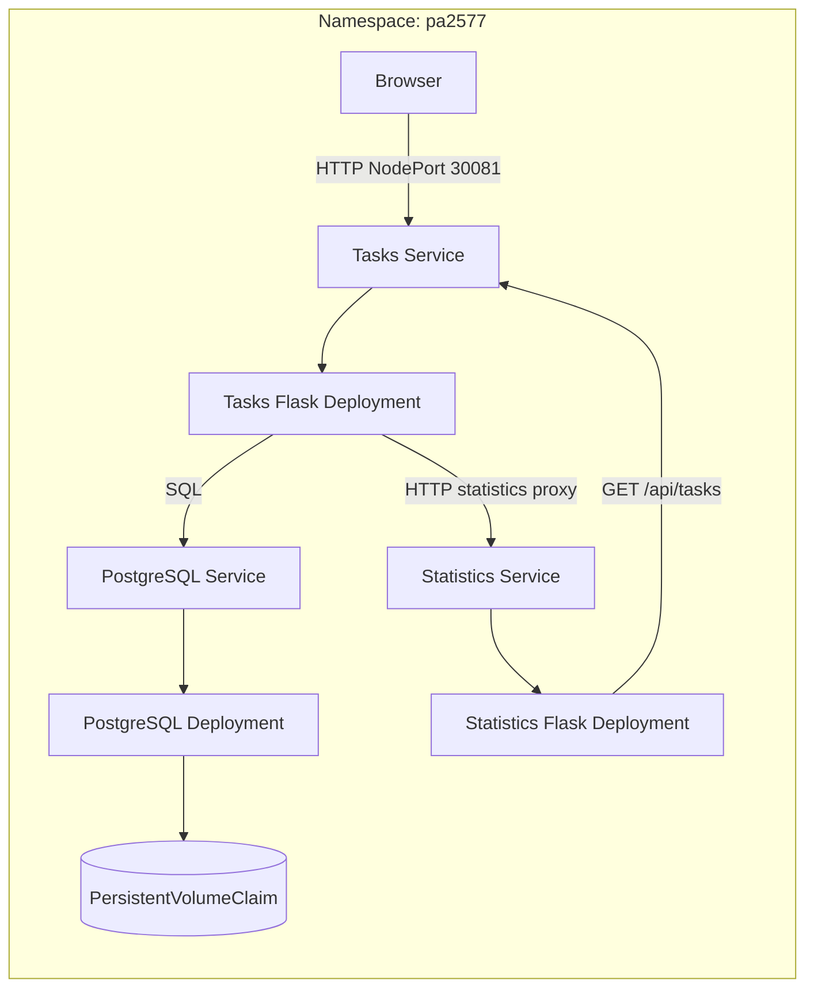

# PA2577 Task Manager

A small cloud-native task manager built for the PA2577 course. Users manage
tasks in a browser. Two Flask microservices expose REST APIs, and PostgreSQL
stores tasks on persistent Kubernetes storage.

Create, edit, complete, and delete tasks, with total/completed/pending counts.
Tasks and Statistics scale separately; PostgreSQL stays at one replica.
Scaling is a course demonstration, not a current workload requirement.
A larger workload with bursts of task-list and statistics requests could justify
scaling the two application services independently.

## Architecture



- **Tasks:** browser UI, task API, and the only application access to PostgreSQL.
- **Statistics:** calculates counts using Tasks' HTTP API; no database access.
- **PostgreSQL:** persistent task storage on a dedicated local PV through a PVC.
- **Helm/Kubernetes:** service discovery, probes, and separate replica settings.

Statistics requests follow Browser -> Tasks proxy -> Statistics -> Tasks list API.
The list endpoint does not call Statistics, so this path is not recursive.

## REST APIs

Base URL in the current Pi deployment: `http://192.168.0.71:30081`.

| Service | Method | Path | Purpose |
| --- | --- | --- | --- |
| Tasks | GET | `/health` | Process health; independent of the database. |
| Tasks | GET | `/ready` | Check database/table availability. |
| Tasks | GET | `/api/tasks` | List tasks. |
| Tasks | POST | `/api/tasks` | Create a task; JSON requires `title`, with optional boolean `completed`. |
| Tasks | PATCH | `/api/tasks/<id>` | Update `title` and/or `completed`. |
| Tasks | DELETE | `/api/tasks/<id>` | Delete a task. |
| Tasks | GET | `/api/statistics` | Proxy statistics from Statistics for the browser. |
| Statistics | GET | `/health` | Statistics process health. |
| Statistics | GET | `/api/statistics` | Return `total`, `completed`, and `pending`, fetched through Tasks HTTP API. |

Invalid task input returns HTTP 400, an unknown task returns 404, and database
unavailability returns a safe HTTP 503 response.

## Local Development

On the Raspberry Pi, from the repository root:

```bash
python3 -m venv .venv
.venv/bin/python -m pip install -r requirements.txt
```

Configure the database using [.env.example](.env.example) in an ignored `.env`
file. Never commit credentials. Start the services in separate terminals:

```bash
.venv/bin/python services/tasks/app.py
```

```bash
TASKS_API_URL=http://127.0.0.1:5000 .venv/bin/python services/statistics/app.py
```

Development servers use `127.0.0.1:5000` and `127.0.0.1:5001`;
container images use Gunicorn.

## Kubernetes Deployment

Helm release and namespace: `pa2577`. Tasks is exposed on NodePort 30081;
Statistics and PostgreSQL are internal. See the [chart guide](helm/pa2577/README.md)
for initial setup, external Secret, and persistent storage requirements.

The latest confirmed deployment is `v0.1.0`, Helm revision **6**, on 2026-10-27.
The [deploy run](https://github.com/icordus/PA2577/actions/runs/40537098402)
reported successful rollouts, image-tag/PVC checks, and read-only HTTP checks.
Editing the chart alone does not update the running release.

Earlier Pi checks demonstrated task persistence after PostgreSQL pod recreation.
This Mac also verified live HTTP responses and loaded the browser UI over the LAN.
Reboot persistence, backup/restore, and representative load remain unverified.

Read-only checks:

```bash
helm status pa2577 --namespace pa2577
kubectl -n pa2577 get deployments,pods,services,pvc
kubectl get pv pa2577-postgres-pv
curl --fail http://192.168.0.71:30081/ready
curl --fail http://192.168.0.71:30081/api/statistics
```

## CI

[CI](.github/workflows/ci.yml) runs in `icordus/PA2577` when a `v*` Git tag is
pushed. It requires `vMAJOR.MINOR.PATCH` (for example `v0.1.1`); branch pushes
and pull requests do not trigger it. There is no manual CI trigger.

1. Build the two ARM64 application images on the self-hosted runner.
2. Test those images over HTTP with isolated, disposable PostgreSQL.
3. Publish each tested image to Docker Hub with the version and full commit SHA tags.

CI also runs offline isolation tests and cleans its temporary resources.
It refuses to overwrite an existing version tag and **does not deploy**.
Configure the repository variable `DOCKERHUB_USERNAME` and secret `DOCKERHUB_TOKEN`.

Sources: [GitHub](https://github.com/icordus/PA2577).
Images: [Tasks](https://hub.docker.com/r/icordus/pa2577-tasks) and
[Statistics](https://hub.docker.com/r/icordus/pa2577-statistics).

## Manual Deploy

[Deploy](.github/workflows/deploy.yml) upgrades the existing `pa2577` release;
it is not the initial cluster setup. The runner needs Helm, kubectl, Python 3,
the expected Kubernetes context, and access to the Pi. The namespace, release,
database Secret, and bound PVC/PV must already exist.

1. Publish a new image version through CI and confirm it succeeded.
2. Set `imageTag` in [values.yaml](helm/pa2577/values.yaml) to that version,
	commit it, and push the branch you want to deploy.
3. After approval, open **Actions > PA2577 Deploy > Run workflow**, select that
	branch, and start the workflow.

Checkout uses the selected branch, including its chart and scripts; it is not
restricted to `main`. GitHub also requires the workflow to exist on the default
branch for manual dispatch to be available.

| Script | Action |
| --- | --- |
| [deploy_init.sh](scripts/deploy_init.sh) | Validate image tag, cluster, storage, Secret, and chart; derive the HTTP URL. |
| [deploy_upgrade.sh](scripts/deploy_upgrade.sh) | Run Helm upgrade with `--wait --timeout 10m --atomic`. |
| [deploy_verify.sh](scripts/deploy_verify.sh) | Check rollouts, image tags, PVC, and HTTP endpoints without creating test data. |
| [deploy_rollback.sh](scripts/deploy_rollback.sh) | On failure, print a manual rollback command; do not execute it. |

Deploy neither rebuilds images nor queries CI status. Helm rolls back a failed
upgrade via `--atomic`; a later verification failure needs operator review and
does not automatically roll back. The run linked above completed the upgrade
and verification steps for `v0.1.0`.

## Verification Status

On 2026-10-27, 21 offline tests passed (16 isolation/CI safety and 5 deployment
validator tests). Helm lint/template, Bash syntax, and workflow YAML checks passed.
The live HTTP verifier and browser page load also passed without test-created data.
CRUD and persistence rely on earlier Pi test reports; they were not repeated in
this review. The older container smoke test still has an unresolved metadata
comparison failure. See [TODO.md](TODO.md) for evidence and outstanding checks.

## Security and Limitations

- Tasks uses a restricted database login; Statistics has no database credentials.
- Passwords stay in an external Kubernetes Secret or ignored local `.env`, not Git.
- Containers use non-root users, reduced capabilities, read-only application filesystems, and probes.
- NodePort is unauthenticated HTTP for a trusted lab network only. HTTPS, firewall policy, and backups are not configured.
- Local storage and replicas on one Pi are not high availability; `Retain` is not a backup.
- CI removes its temporary, unencrypted Docker login configuration during cleanup.
- Reported Docker socket mode `0666` grants effectively root-level local access and needs administrative review.

## Benefits and Challenges

Separate services allow independent scaling; Helm and versioned images make
deployment repeatable. This adds operational complexity to a small application.
A single Pi keeps hardware costs low but provides no node-level failover.
A production setup would need multiple nodes, resilient storage, authenticated
HTTPS, monitoring, and tested backups.

## Submission Video

The required 5-10 minute recording is not yet attached. Show the UI and APIs,
explain the architecture, then demonstrate Kubernetes resources, logs, scaling,
and PostgreSQL pod-recreation persistence. State the unverified limits above.
