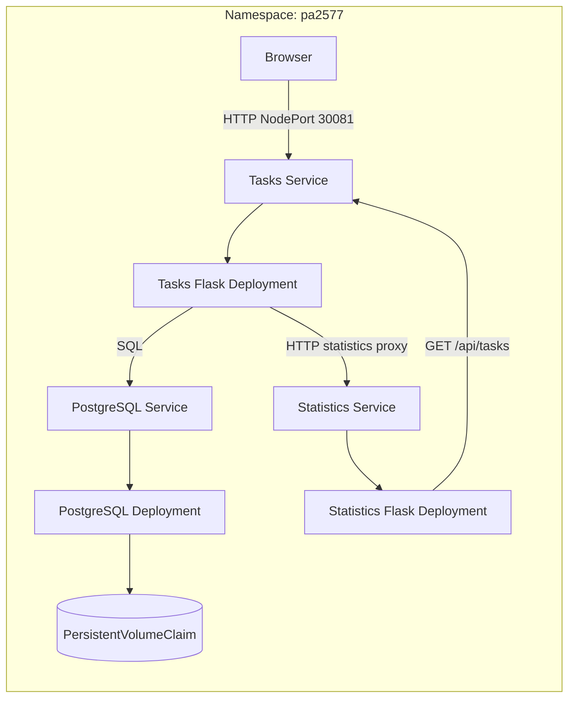

# PA2577 Task Manager

A small cloud-native task manager built for the PA2577 course. Users manage
tasks in a browser. Two Flask microservices expose REST APIs, and PostgreSQL
stores tasks on persistent Kubernetes storage.

## Features

- Create, list, complete, update, and delete tasks.
- View total, completed, and pending task counts.
- Store tasks in a separate PostgreSQL service.
- Run Tasks and Statistics as independently scalable Kubernetes Deployments.

This application is intentionally small and does not need replicas for its
current workload. Scaling demonstrates the Kubernetes pattern. A future
workload with many users and bursts of task-list/statistics requests could
justify scaling the stateless Flask services; PostgreSQL remains a single
instance for this project.

## Architecture



### Components

| Component | Responsibility |
| --- | --- |
| Tasks (Flask) | Serves the browser UI and task REST API. It is the only application service that accesses PostgreSQL. It proxies browser statistics requests to Statistics. |
| Statistics (Flask) | Provides a statistics REST API. It calls Tasks over HTTP and never accesses PostgreSQL. |
| PostgreSQL | Stores task records. It runs separately and uses a persistent volume claim. |
| Kubernetes Services | Provide in-cluster DNS and route traffic to independently scalable Deployments. Tasks is exposed outside the cluster through NodePort 30081. |
| Helm chart | Defines the namespace, Deployments, Services, PostgreSQL, PVC, probes, resource limits, and configurable Flask replica counts. |

The statistics path is non-recursive: Browser -> Tasks statistics proxy ->
Statistics -> Tasks `GET /api/tasks`. Tasks' list endpoint does not call
Statistics.

### Cloud Patterns

- **Service decomposition:** task ownership and statistics calculation live in separate services.
- **Service discovery:** in-cluster communication uses Kubernetes Service DNS.
- **Stateless scaling:** Tasks and Statistics have separate replica settings; PostgreSQL remains one replica.
- **Persistent state:** PostgreSQL uses a PVC backed by a dedicated local PV with `Retain` reclaim policy.
- **Health-based orchestration:** Kubernetes probes gate startup, readiness, and liveness.
- **Build once, deploy by version:** CI tests ARM64 images and publishes each tested image ID under both a fixed release tag and the full commit SHA.

## REST APIs

Base URL in the current Pi deployment: `http://192.168.0.71:30081`.

| Service | Method | Path | Purpose |
| --- | --- | --- | --- |
| Tasks | GET | `/health` | Process health; independent of the database. |
| Tasks | GET | `/ready` | Check database/table availability. |
| Tasks | GET | `/api/tasks` | List tasks. |
| Tasks | POST | `/api/tasks` | Create a task; JSON requires `title`, with optional boolean `completed`. |
| Tasks | PATCH | `/api/tasks/<id>` | Update `title` and/or `completed`. |
| Tasks | DELETE | `/api/tasks/<id>` | Delete a task. |
| Tasks | GET | `/api/statistics` | Proxy statistics from Statistics for the browser. |
| Statistics | GET | `/health` | Statistics process health. |
| Statistics | GET | `/api/statistics` | Return `total`, `completed`, and `pending`, fetched through Tasks HTTP API. |

Invalid task input returns HTTP 400, an unknown task returns 404, and database
unavailability returns a safe HTTP 503 response.

## Local Development

Run on the Raspberry Pi from the repository root. Create the virtual
environment and install dependencies:

```bash
python3 -m venv .venv
.venv/bin/python -m pip install -r requirements.txt
```

Configure the Tasks database connection in the ignored `.env` file using the
keys shown in `.env.example`. Never commit `.env` or paste its values into logs
or chat. Start Tasks and Statistics in separate terminals:

```bash
.venv/bin/python services/tasks/app.py
```

```bash
TASKS_API_URL=http://127.0.0.1:5000 .venv/bin/python services/statistics/app.py
```

The local development servers listen on `127.0.0.1:5000` and
`127.0.0.1:5001`. These are development servers; the container images use
Gunicorn.

## Kubernetes Deployment

The project is deployed with the Helm chart in [`helm/pa2577`](helm/pa2577/README.md),
in namespace `pa2577`. Tasks is reachable on NodePort 30081. The deployed
Tasks and Statistics images use commit `5c65f2dcd675a1bc8b6d1b378bd10ba1b999b721`:

- `docker.io/icordus/pa2577-tasks:5c65f2dcd675a1bc8b6d1b378bd10ba1b999b721`
- `docker.io/icordus/pa2577-statistics:5c65f2dcd675a1bc8b6d1b378bd10ba1b999b721`

The chart default is now `v0.1.0` for a readable release tag. The already
deployed Helm release remains on the SHA above until a later approved upgrade;
the `v0.1.0` tags must first be published by manually dispatching CI with
`image_version=v0.1.0`. CI also retains the full SHA tags.

The first Helm deployment and HTTP checks on the Pi were reported successful.
PostgreSQL pod recreation preserved the test task and PVC/PV identity. Pi reboot
survival, backup/restore, access from another user's device, and performance
under representative load have not been verified. Deployment and Helm upgrade
commands change cluster resources; get explicit approval before running them.

Read-only checks:

```bash
helm status pa2577 --namespace pa2577
kubectl -n pa2577 get deployments,pods,services,pvc
kubectl get pv pa2577-postgres-pv
curl --fail http://192.168.0.71:30081/ready
curl --fail http://192.168.0.71:30081/api/statistics
```

## CI

The GitHub Actions workflow is [`.github/workflows/ci.yml`](.github/workflows/ci.yml).
It runs only when manually dispatched from `main`; pushes and pull requests do
not trigger it. It builds
ARM64 images, runs isolated HTTP integration tests with disposable PostgreSQL,
and publishes the tested image IDs with both the full commit SHA and the fixed
version supplied at dispatch (for example `v0.1.0`). Choose a new version for
each release; CI refuses to overwrite an existing version tag. Repository
settings required are the `DOCKERHUB_USERNAME` variable and `DOCKERHUB_TOKEN` secret.
CI does not deploy to Kubernetes. Deployment workflow automation remains TODO.

## Security and Limitations

- Tasks uses a dedicated PostgreSQL login with limited privileges; Statistics has no database credentials.
- Database passwords are kept outside Git in a Kubernetes Secret. The local `.env` is ignored and owner-readable only.
- Containers run as non-root, drop Linux capabilities, use read-only application filesystems, and have health probes.
- NodePort uses plain HTTP and has no authentication. It is intended for a trusted lab network, not direct Internet exposure. HTTPS, user authentication, firewall policy, and backups are not configured.
- The PVC uses a local PV on one Raspberry Pi. `Retain` helps avoid accidental reclamation, but does not protect against disk/Pi failure. Replicas on the same Pi are not high availability.
- The CI job temporarily stores Docker login configuration in its runner temp directory and removes it during cleanup; the workflow log warned that the stored credential is not encrypted.
- The Pi Docker socket was reported with mode `0666`; that grants local users effectively root-level Docker access and needs administrative review.

## Benefits and Challenges

The design separates task management from statistics, allows each stateless
service to scale independently, and makes deployment repeatable with Helm and
versioned images. The trade-offs are extra services, configuration, CI, and
cluster operations for an application that could run as one process. A local PV
is inexpensive and simple for a single-node course demo, but couples storage to
one Pi. A real higher-load design would also need multiple nodes, managed/shared
storage, authenticated HTTPS ingress, monitoring, and tested backups.

## Submission Video

The required 5-10 minute recording is not yet attached. Suggested outline:

1. Explain the app and why a hypothetical high request volume might justify scaling.
2. Show the browser UI and task/statistics APIs.
3. Explain Tasks, Statistics, PostgreSQL, and their HTTP/SQL responsibilities.
4. Show the Kubernetes workloads, Services, PVC/PV, logs, and Helm templates.
5. Demonstrate scaling and PostgreSQL pod-recreation persistence; state that reboot, external-device access, and backups remain unverified.
