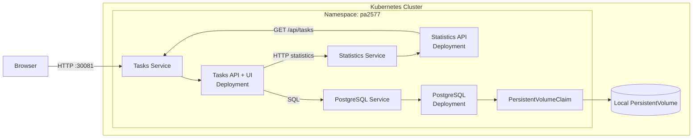

# PA2577 Task Manager

A course project with two Python/Flask services and PostgreSQL. The browser UI
uses server-rendered Jinja templates, HTML forms, and CSS: no JavaScript or
frontend build tools. Create, edit, complete, and delete tasks and view counters.
Forms reload the page; the REST APIs remain available for other clients.

## Architecture



- **Tasks:** UI and REST API; the only application access to PostgreSQL.
- **Statistics:** counts tasks through Tasks' HTTP API; no database access.
- **PostgreSQL:** one replica, persistent data through PVC -> local PV.
- **Docker, Kubernetes, Helm:** application images, Services, probes, and replica settings.

Page rendering follows Browser -> Tasks -> Statistics -> Tasks list API.
The list API does not call Statistics, so requests do not recurse.

## REST APIs

Base URL in the current Pi deployment: `http://192.168.0.71:30081`.

| Service | Method | Path | Purpose |
| --- | --- | --- | --- |
| Tasks | GET | `/health` | Process health; independent of the database. |
| Tasks | GET | `/ready` | Check database/table availability. |
| Tasks | GET | `/api/tasks` | List tasks. |
| Tasks | POST | `/api/tasks` | Create a task; JSON requires `title`, with optional boolean `completed`. |
| Tasks | PATCH | `/api/tasks/<id>` | Update `title` and/or `completed`. |
| Tasks | DELETE | `/api/tasks/<id>` | Delete a task. |
| Tasks | GET | `/api/statistics` | Proxy statistics from Statistics for the browser. |
| Statistics | GET | `/health` | Statistics process health. |
| Statistics | GET | `/api/statistics` | Return `total`, `completed`, and `pending`, fetched through Tasks HTTP API. |

Invalid task input returns HTTP 400, an unknown task returns 404, and database
unavailability returns a safe HTTP 503 response.

## Local Development

On the Raspberry Pi, from the repository root:

```bash
python3 -m venv .venv
.venv/bin/python -m pip install -r requirements.txt
```

Configure the database using [.env.example](.env.example) in an ignored `.env`
file. Never commit credentials. Start the services in separate terminals:

```bash
.venv/bin/python services/tasks/app.py
```

```bash
TASKS_API_URL=http://127.0.0.1:5000 .venv/bin/python services/statistics/app.py
```

Development servers use `127.0.0.1:5000` and `127.0.0.1:5001`;
container images use Gunicorn.

## Kubernetes Deployment

Helm release and namespace: `pa2577`. Tasks is exposed on NodePort 30081;
Statistics and PostgreSQL are internal. See the [chart guide](helm/pa2577/README.md)
for initial setup, external Secret, and persistent storage requirements.

Latest confirmed release: `v0.1.0`, Helm revision **6**;
[successful deploy](https://github.com/icordus/PA2577/actions/runs/40537098402).
The new JavaScript-free UI is a local change, not part of that verified release.
Publish a new version and approve its deployment before demonstrating it on the Pi.

Read-only checks:

```bash
helm status pa2577 --namespace pa2577
kubectl -n pa2577 get deployments,pods,services,pvc
kubectl get pv pa2577-postgres-pv
curl --fail http://192.168.0.71:30081/ready
curl --fail http://192.168.0.71:30081/api/statistics
```

## CI

[CI](.github/workflows/ci.yml) runs in `icordus/PA2577` when a `v*` Git tag is
pushed. It requires `vMAJOR.MINOR.PATCH` (for example `v0.1.1`); branch pushes
and pull requests do not trigger it. There is no manual CI trigger.

1. Build the two ARM64 application images on the self-hosted runner.
2. Test those images over HTTP with isolated, disposable PostgreSQL.
3. Publish each tested image to Docker Hub with the version and full commit SHA tags.

CI cleans its temporary resources, refuses existing version tags, and **does not deploy**.

### Docker Hub Configuration

In GitHub, open **Settings > Secrets and variables > Actions** and configure:

- **Variables > New repository variable:** `DOCKERHUB_USERNAME` = your Docker Hub username (`icordus` for this chart).
- **Secrets > New repository secret:** `DOCKERHUB_TOKEN` = a Docker Hub personal access token with **Read & Write** permissions.

Create the token in Docker Hub account settings; never commit it. Deploy does not use it.

Sources: [GitHub](https://github.com/icordus/PA2577).
Images: [Tasks](https://hub.docker.com/r/icordus/pa2577-tasks) and
[Statistics](https://hub.docker.com/r/icordus/pa2577-statistics).

## Manual Deploy

[Deploy](.github/workflows/deploy.yml) requires the existing release, namespace,
database Secret, and bound PVC/PV. The runner needs Helm, kubectl, Python 3,
and the expected cluster context. Initial setup is in the chart guide.

1. Publish a new image version through CI and confirm it succeeded.
2. Set `imageTag` in [values.yaml](helm/pa2577/values.yaml) to that version,
	commit it, and push the branch you want to deploy.
3. After approval, open **Actions > PA2577 Deploy > Run workflow**, select that
	branch, and start the workflow.

The selected branch supplies the chart and scripts, not necessarily `main`.
GitHub requires the workflow on the default branch for manual dispatch.
Deploy validates prerequisites, upgrades Helm with `--wait --timeout 10m --atomic`,
then checks rollouts, images, PVC, and read-only HTTP responses. It does not
rebuild images or query CI. Helm rolls back upgrade failures; later verification
failures only print manual rollback guidance.

## Verification and Limitations

Run the local, mocked tests without Docker or a database:

```bash
.venv/bin/python -m unittest discover -s tests -p test_tasks_web.py -v
.venv/bin/python -m unittest discover -s tests -p test_integration_safety.py -v
.venv/bin/python -m unittest discover -s tests -p test_deployment_http.py -v
```

Earlier Pi reports confirmed isolated HTTP integration, independent scaling,
and persistence after PostgreSQL pod recreation. The new UI passed 38 local
tests and browser CRUD checks with JavaScript disabled and simulated dependencies;
3 live-test suites were intentionally skipped. See [TODO.md](TODO.md) for
pending deployment checks and the unresolved legacy smoke-test failure.

- Restricted database login, external Secrets, non-root containers, and read-only application filesystems.
- Browser forms require a matching Origin; the JSON APIs remain unauthenticated.
- NodePort uses HTTP without authentication: trusted lab network only.
- One Pi and a local PV are not high availability; `Retain` is not a backup.
- Reboot persistence, backup/restore, and representative load remain unverified.
- CI removes temporary Docker credentials during cleanup; never commit credentials.

Separate services demonstrate independent scaling and repeatable deployment,
but add complexity. This small app does not need replicas; bursts of requests
could justify them. One Pi is inexpensive, while production would need resilient
storage, multiple nodes, authenticated HTTPS, monitoring, and backups.

## Maintenance and Security

Monitor security advisories for dependencies and container images. When affected,
update the vulnerable versions, run tests, and rebuild/publish images through CI
with a new release tag. Update `imageTag`, approve the manual deploy, and verify
the rollout and HTTP checks. Rotate any exposed credentials. Before PostgreSQL
updates, make a verified backup and check migration requirements; never delete the PVC/PV.
